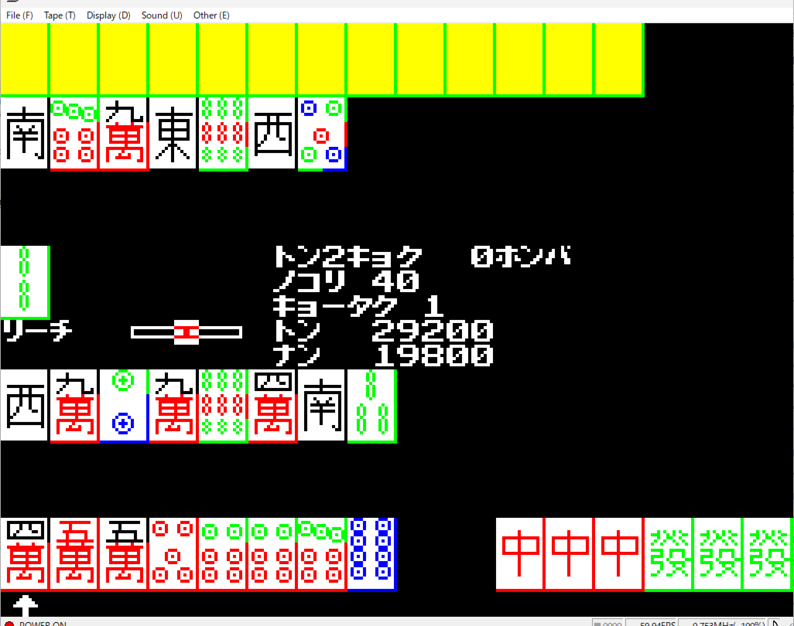
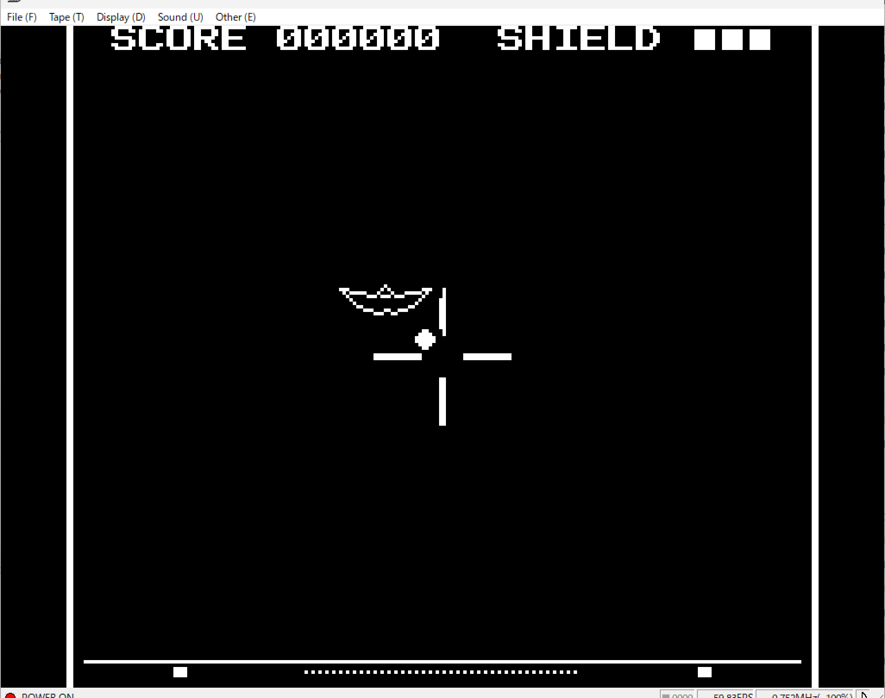

# experiments-by-ai

A collection of AI-generated programs to evaluate AI's limits on retro 8-bit PCs (BASICMASTER).

---

## About This Repository

This repository is a collection of programs and scripts generated by AI (such as ChatGPT and Claude).  
The main goal is to test and evaluate how well AI can understand and write code for retro 8-bit computers, especially the **Hitachi BASICMASTER** series.

- **Purpose**: To evaluate AI's capabilities and limits on vintage 8-bit architectures.
- **Maintenance**: No long-term maintenance is planned. These are just experimental logs.

---

## 概要 (Japanese)

このリポジトリは、レトロ8ビットPC（主に日立ベーシックマスターシリーズ）におけるAIのコーディング能力や限界を評価・検証するための実験用プログラム集です。

- **目的**: 8ビットCPU（MC6800等）やBASIC環境に対して、AIがどの程度正確なコードを出力できるかのテスト・記録
- **保守方針**: 実験・評価ログのため、長期的なメンテナンスやバグ修正等のサポートは予定していません。

---

## サンプル画像

---

## Directory Structure / プロジェクト一覧

- [bmjr-block-break](./bmjr-block-break)
- [bmjr-color-invaders](./bmjr-color-invaders)
- [bmjr-color-mahjong-2players](./bmjr-color-mahjong-2players)
- [bmjr-space-war](./bmjr-space-war)
- [bmjr-tennis](./bmjr-tennis)

