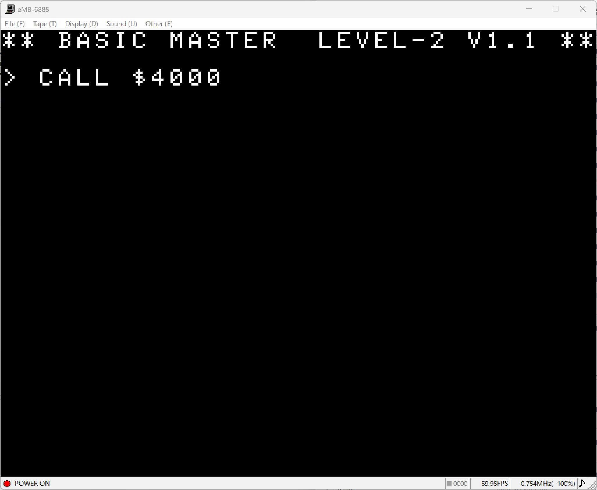
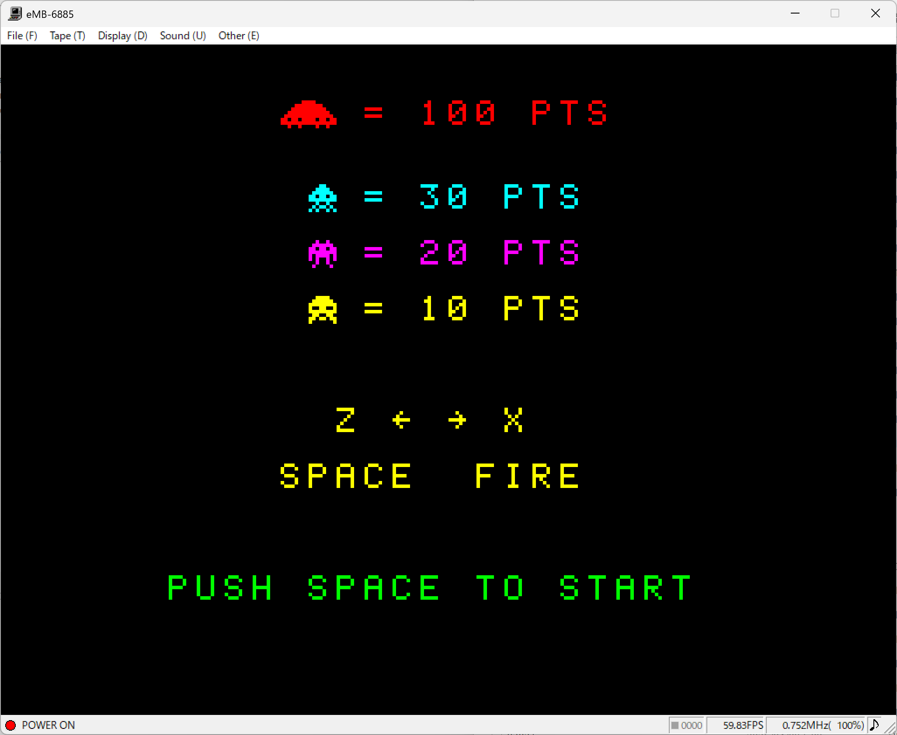
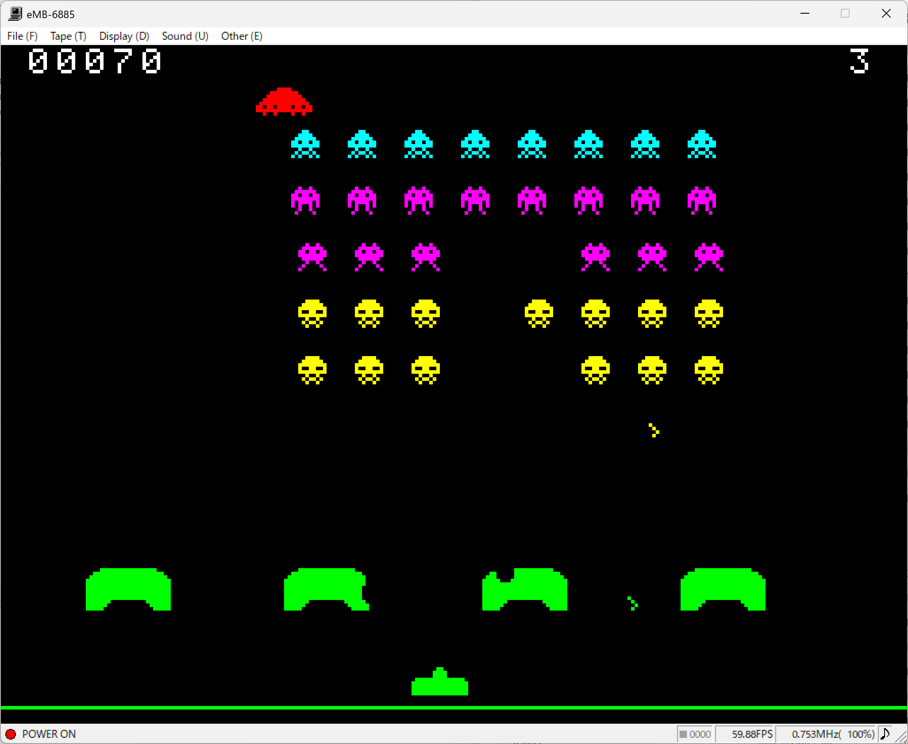

# bmjr-space-invaders

An AI-generated Space Invaders game for the Hitachi BASICMASTER series (Retro 8-bit PC).

## Screenshots

### Initial Screen & Startup

### How to Play / Title

### Game Screen

## How to Run

1. Load `invaders.mot` into your Hitachi BASICMASTER emulator.
2. Type `CALL $4000` and press **Enter** to start the game.

## Controls

* **Z**: Move Left
* **X**: Move Right
* **Space**: Fire

## About This Experiment

This is an experimental program to test AI's capability in developing a complete retro computer game for 8-bit architecture. It evaluates how well AI can generate assembly/machine code, handle sprite animation, manage enemy group movement, process collision detection, and handle real-time user input.