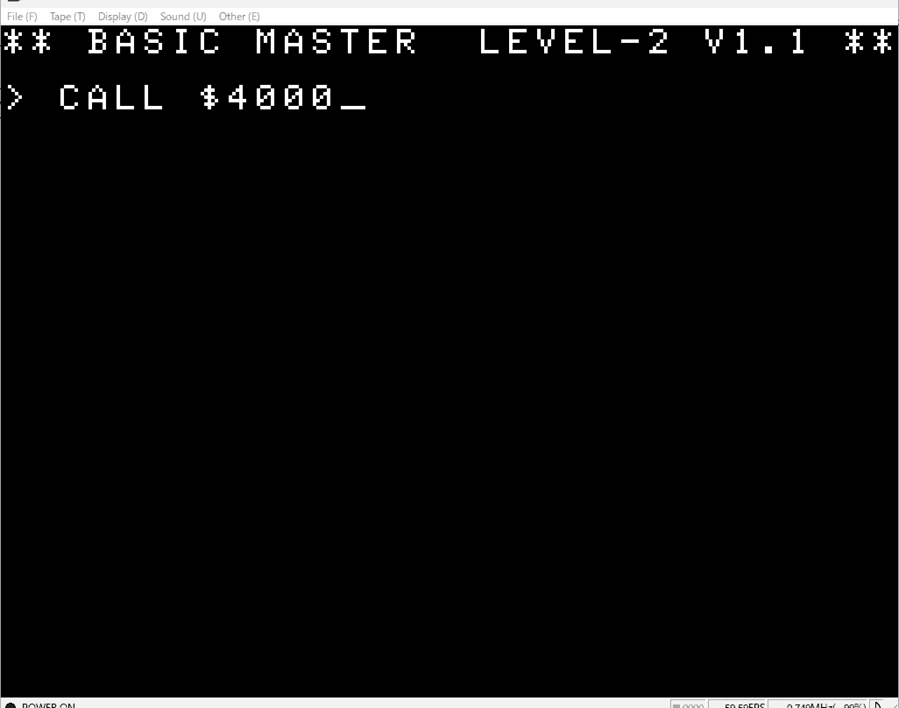
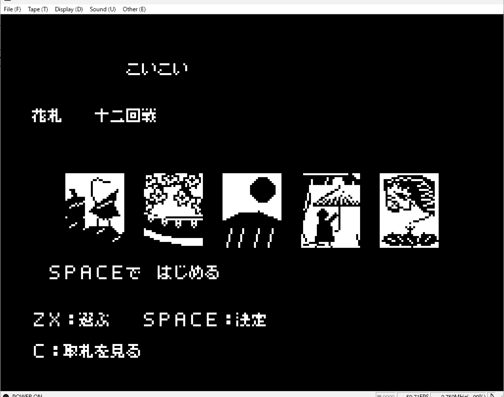
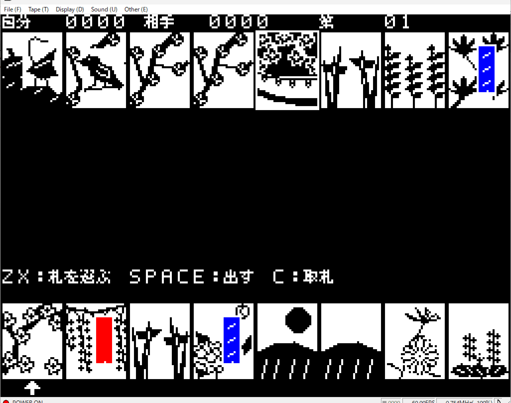
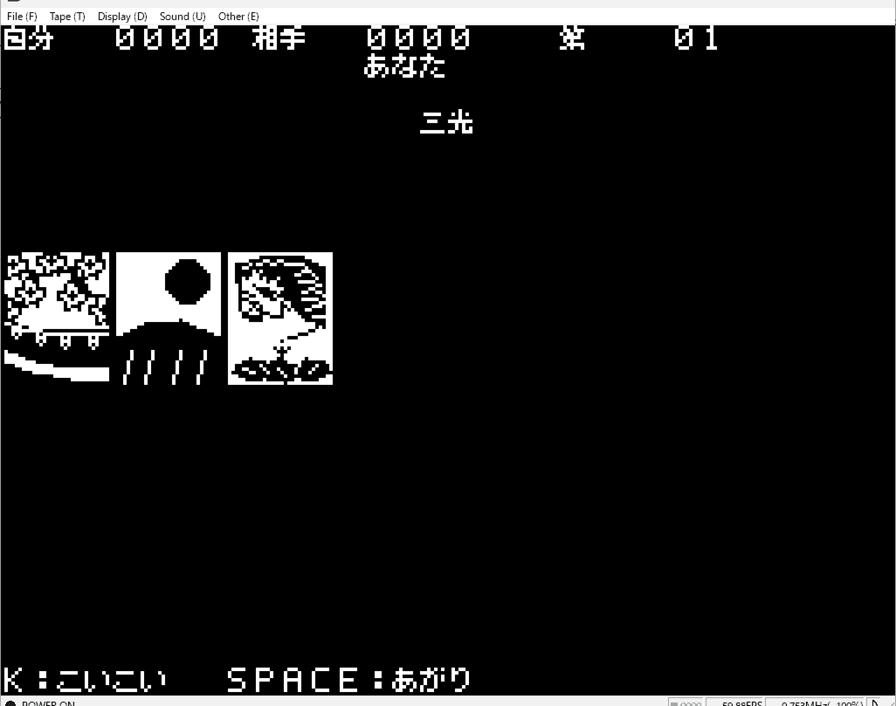

## bmjr-color-koikoi

An AI-generated Hanafuda (Koikoi) game (12 rounds) for the Hitachi BASICMASTER series (Retro 8-bit PC).

### Screenshots

**Initial Screen & Startup**  

**Title & Controls**  

**In-Game Screen**  

**Win Screen**  

### How to Run
1. Load the program into your BASICMASTER Jr. emulator.
2. Type `CALL $4000` and press Enter to start the game.

### Controls
- **Z** / **X**: Select cards / Move (選ぶ)
- **Space**: Start, confirm, discard, or declare win (はじめる / 決定 / 出す / あがり)
- **C**: View captured cards (取札を見る)
- **K**: Declare Koikoi (こいこい)

### About this experiment
This is an experimental program to test AI's capability in developing a complete retro computer game, including rules, UI rendering, and player controls for 8-bit architecture.
