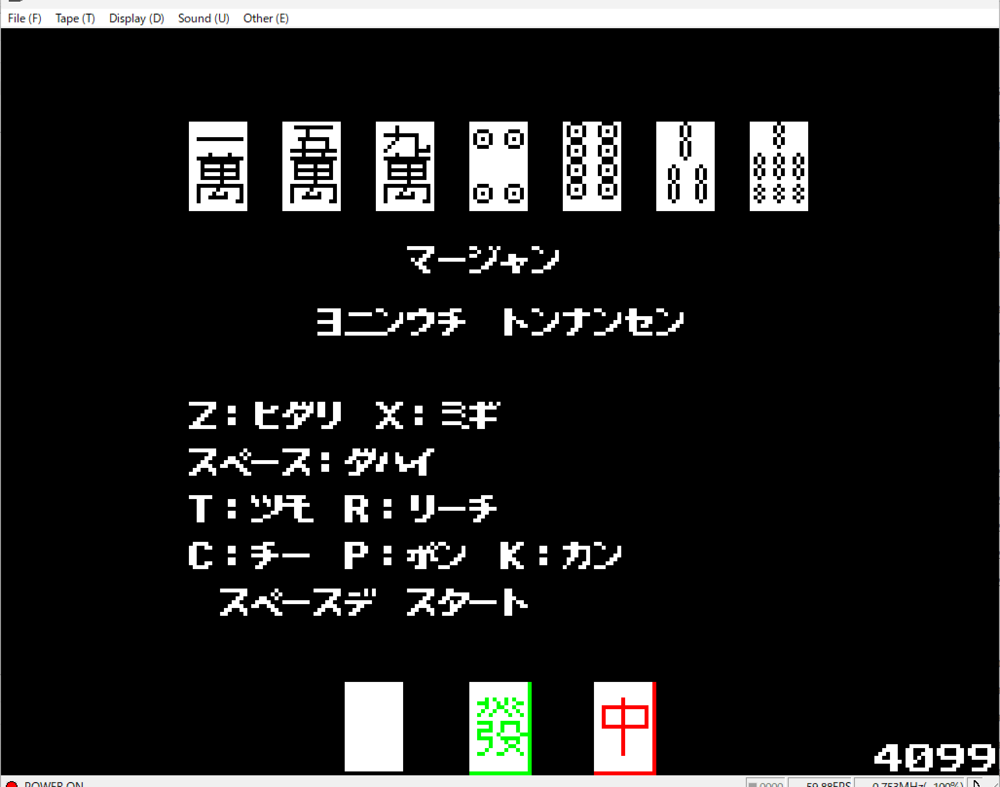
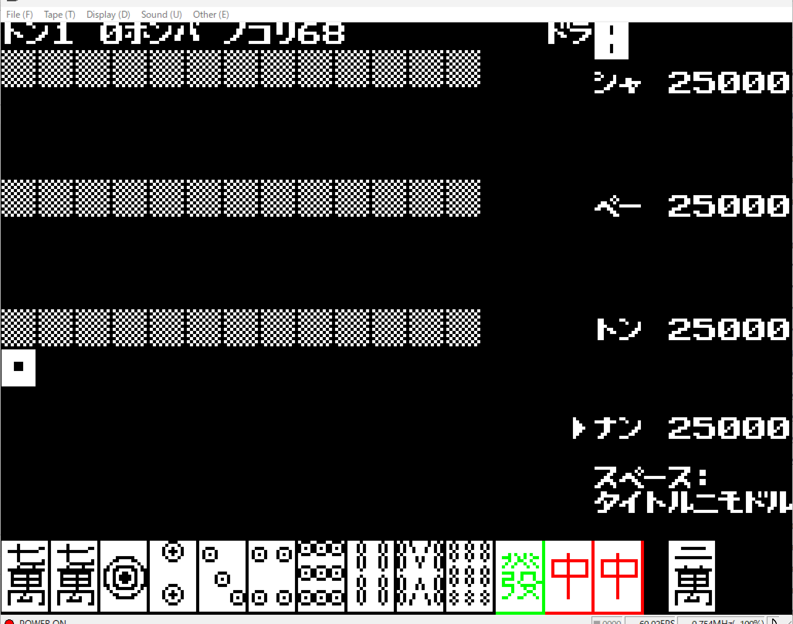
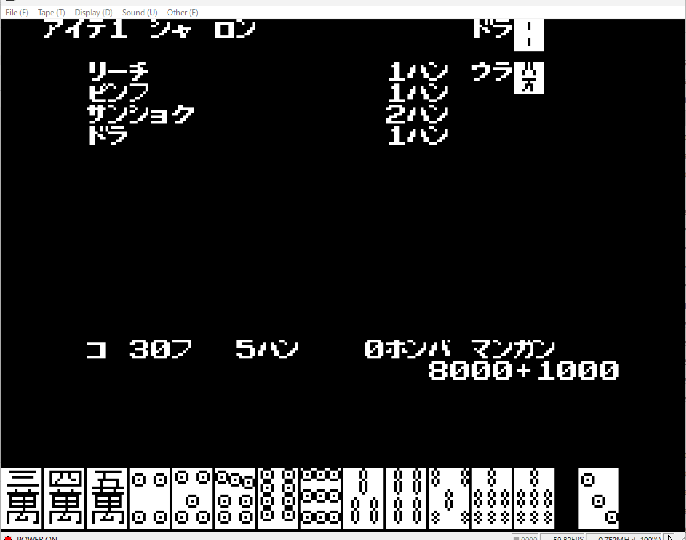
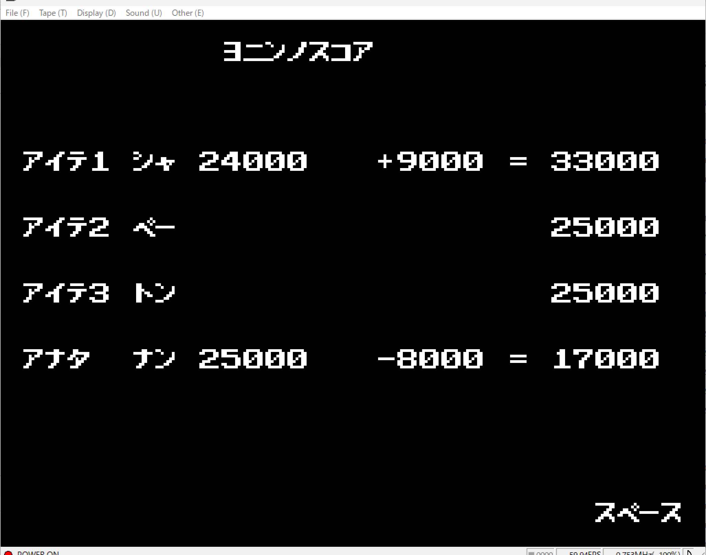

## bmjr-color-mahjong-4player

An AI-generated 4-player Mahjong game (Yonin-uchi Tonnan-sen / 4-player East-South game) for the Hitachi BASICMASTER series (Retro 8-bit PC).

### Screenshots

**Title & Controls**  

**In-Game Screen**  

**Win / Hand Result Screen**  

**4-Player Scoreboard Screen**  

### How to Run
1. Load `mj4.mot` into your BASICMASTER Jr. emulator.
2. Type `CALL $4000` and press Enter to start the game.

### Controls
- **Z**: Move Left (ヒダリ)
- **X**: Move Right (ミギ)
- **Space**: Discard / Start / Return to Title / Next (ダハイ / スタート / タイトルニモドル)
- **T**: Tsumo (ツモ)
- **R**: Riichi (リーチ)
- **C**: Chi (チー)
- **P**: Pon (ポン)
- **K**: Kan (カン)

### About this experiment
This is an experimental program to test AI's capability in developing a complete retro computer game, including rules, UI rendering, and player controls for 8-bit architecture.
