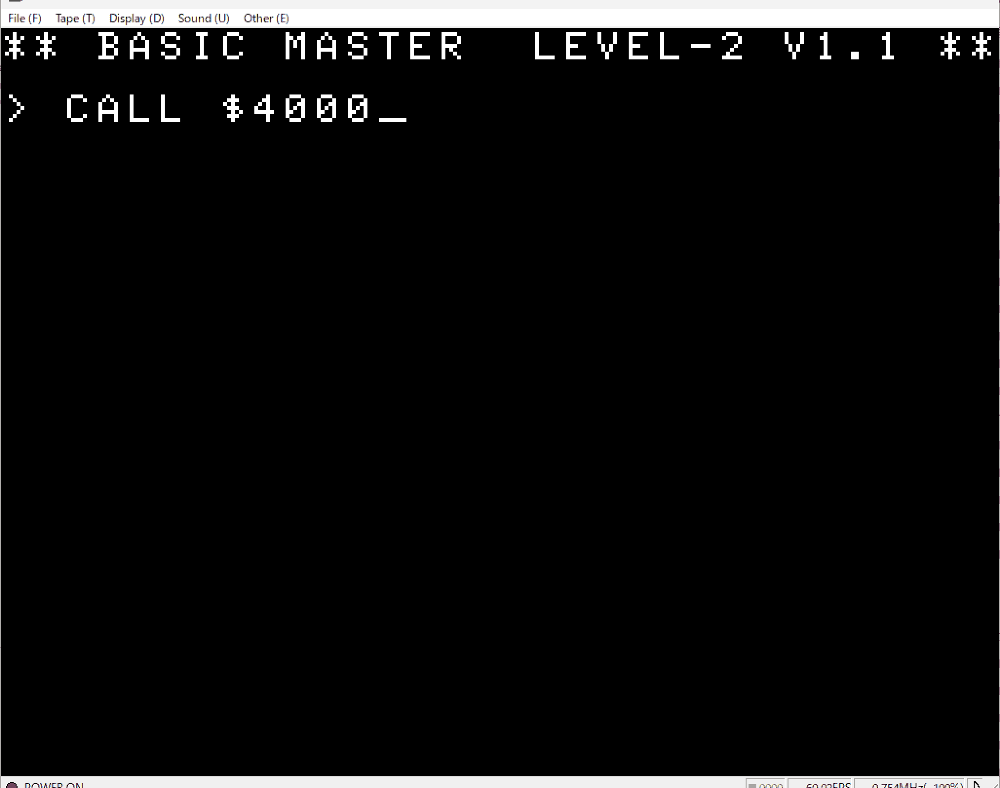
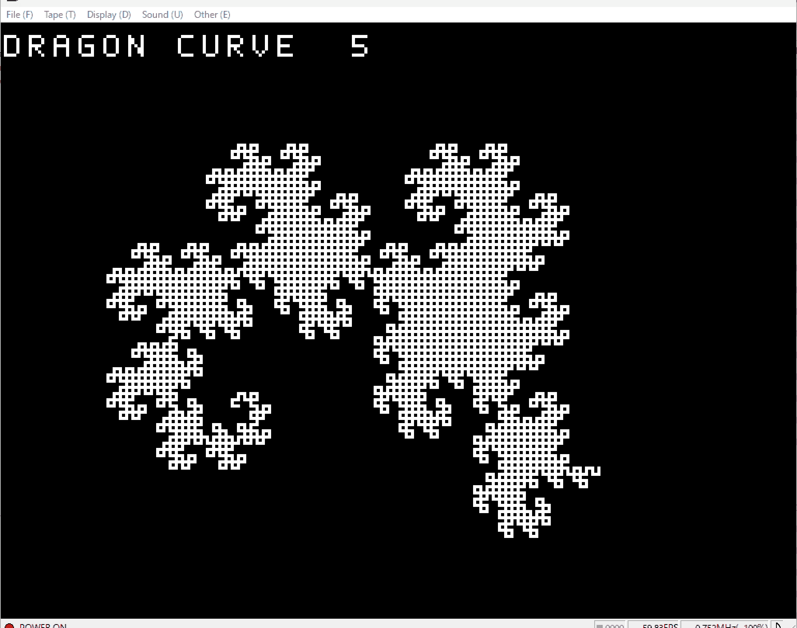
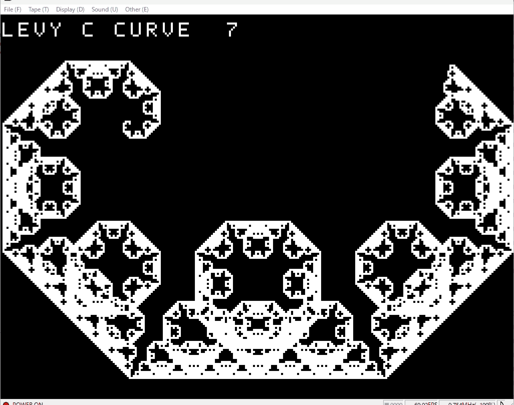

# bmjr-fractal

An AI-generated mathematical curve and fractal demonstration program for the Hitachi BASICMASTER series (Retro 8-bit PC).

## Screenshots

### Initial Screen & Startup

### Dragon Curve

### Lévy C Curve

## How to Run

1. Load `bmjr-math-demo.mot` into your Hitachi BASICMASTER emulator.
2. Type `CALL $4000` and press **Enter** to start the demo.

## Features

This demonstration renders various mathematical fractal curves and geometric figures.

## About This Experiment

This is an experimental program to test AI's capability in developing mathematical graphic demonstrations for 8-bit architecture. It evaluates how well AI can generate assembly/machine code, handle recursive/iterative algorithm execution, manage low-level VRAM rendering, and draw complex geometric patterns on vintage hardware.
