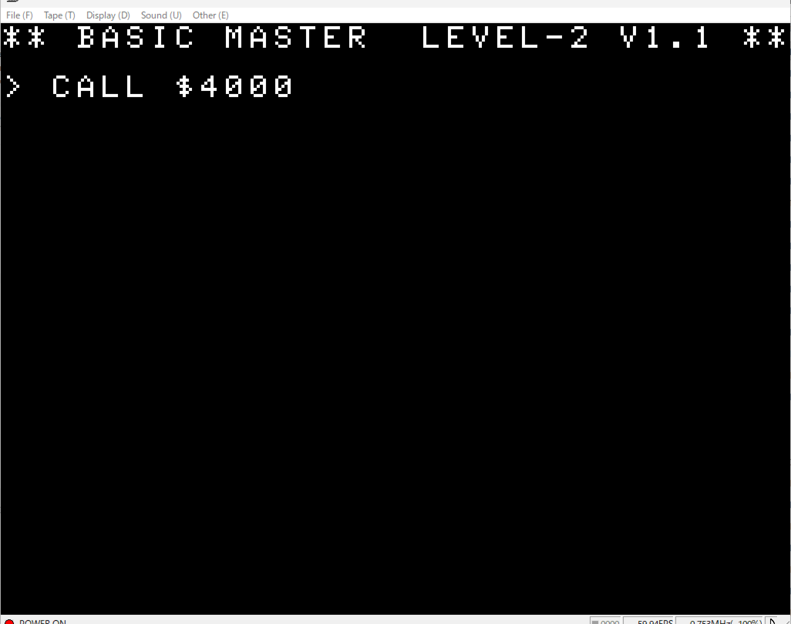
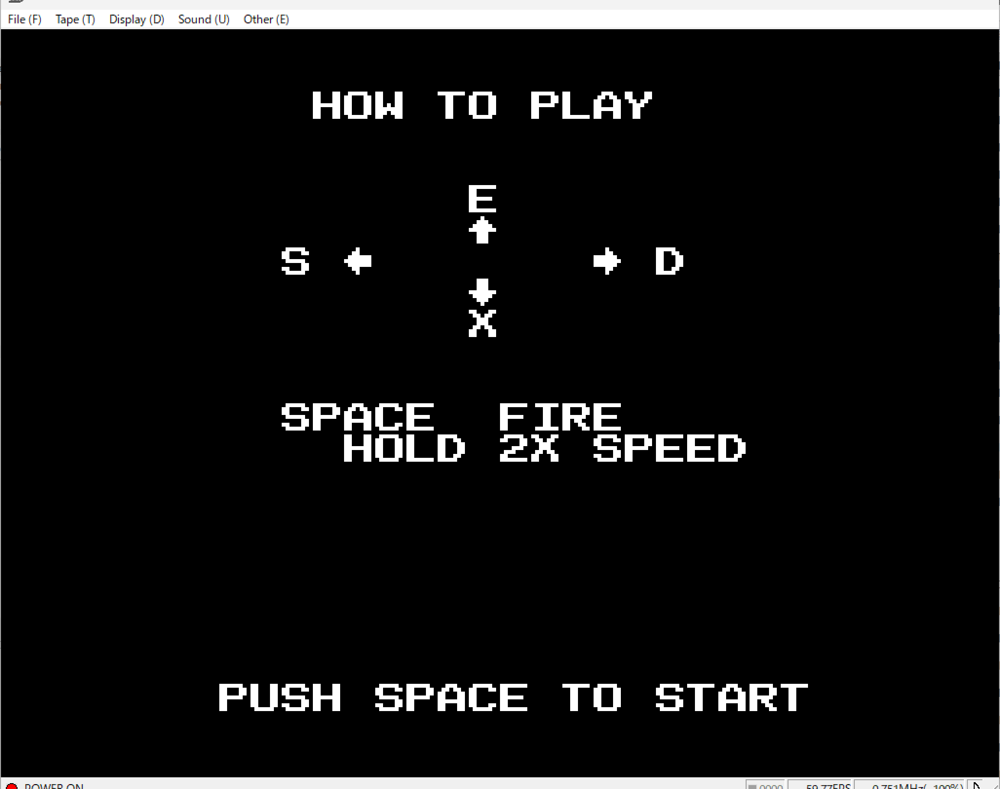

# bmjr-spacewar

An AI-generated Space War game for the Hitachi BASICMASTER series (Retro 8-bit PC).

## Screenshots

### Initial Screen & Startup

### How to Play

### Game Screen

## How to Run

1. Load `spacewar.mot` into your Hitachi BASICMASTER emulator.
2. Type `CALL $4000` and press **Enter** to start the game.

## Controls

* **E**: Move Up
* **X**: Move Down
* **S**: Move Left
* **D**: Move Right
* **Space**: Fire / Hold for 2X Speed

## About This Experiment

This is an experimental program to test AI's capability in developing a complete retro computer game for 8-bit architecture. It evaluates how well AI can generate assembly/machine code, handle real-time physics, manage screen rendering, and process user input.
