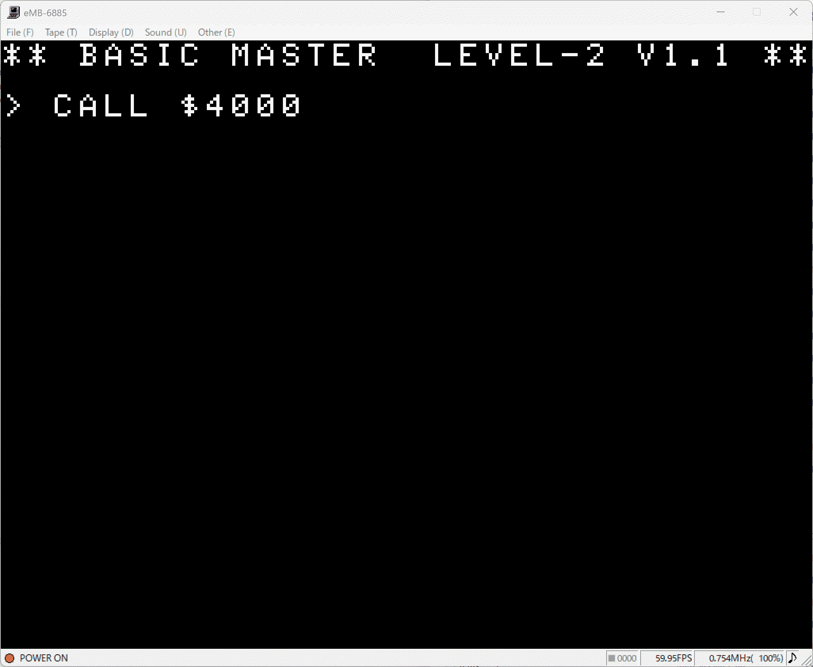
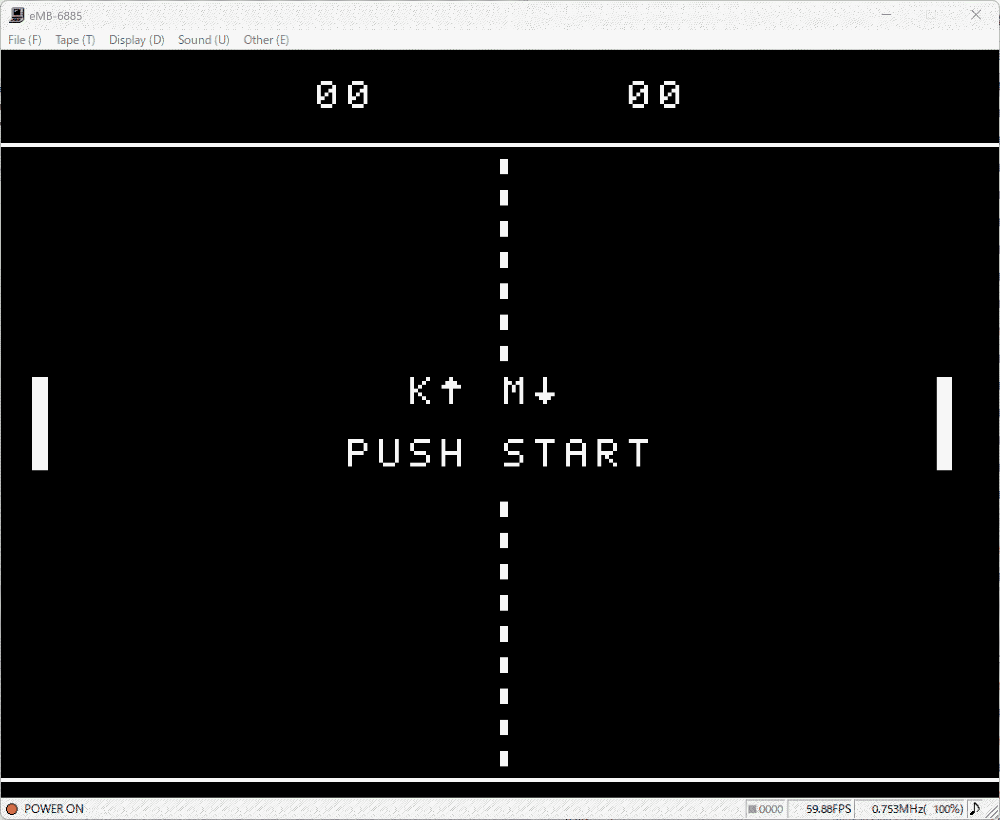
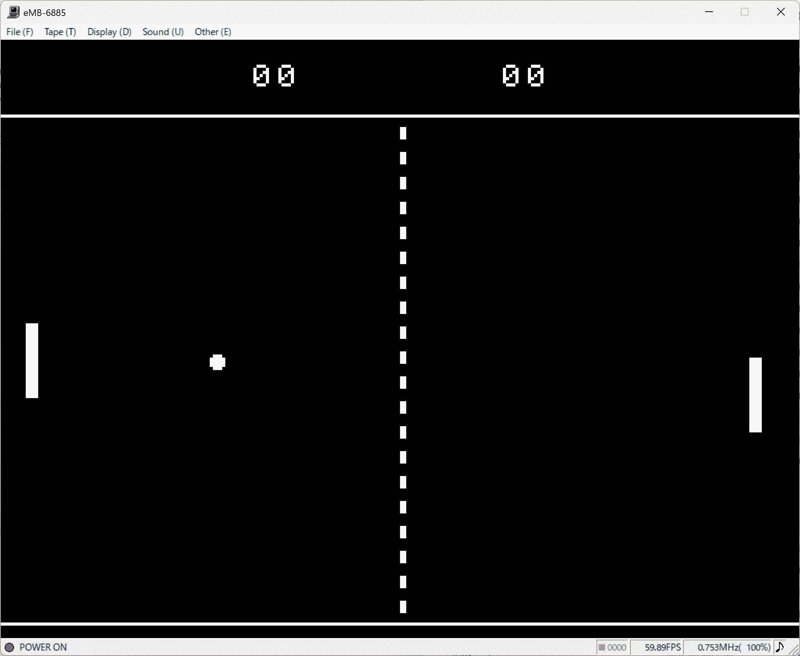
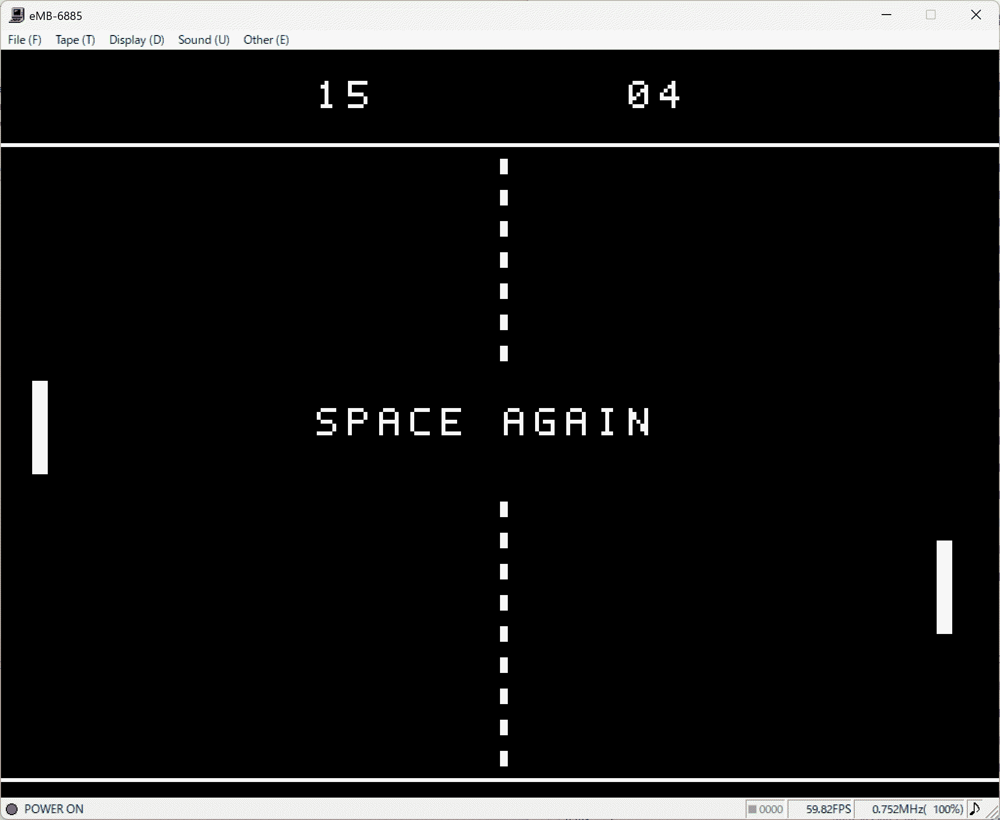

# bmjr-pong

An AI-generated Pong game for the Hitachi BASICMASTER series (Retro 8-bit PC).

## Screenshots

### Initial Screen & Startup

### How to Play & Game Start

### Game Screen

### Game Over / Restart

## How to Run

1. Load `pong.mot` into your Hitachi BASICMASTER emulator.
2. Type `CALL $4000` and press **Enter** to start the game.

## Controls

* **K**: Move Up / Start
* **M**: Move Down / Start
* **Space**: Restart Game

## About This Experiment

This is an experimental program to test AI's capability in developing a complete retro computer game for 8-bit architecture. It evaluates how well AI can generate assembly/machine code, handle real-time physics, manage screen rendering, and process user input.
